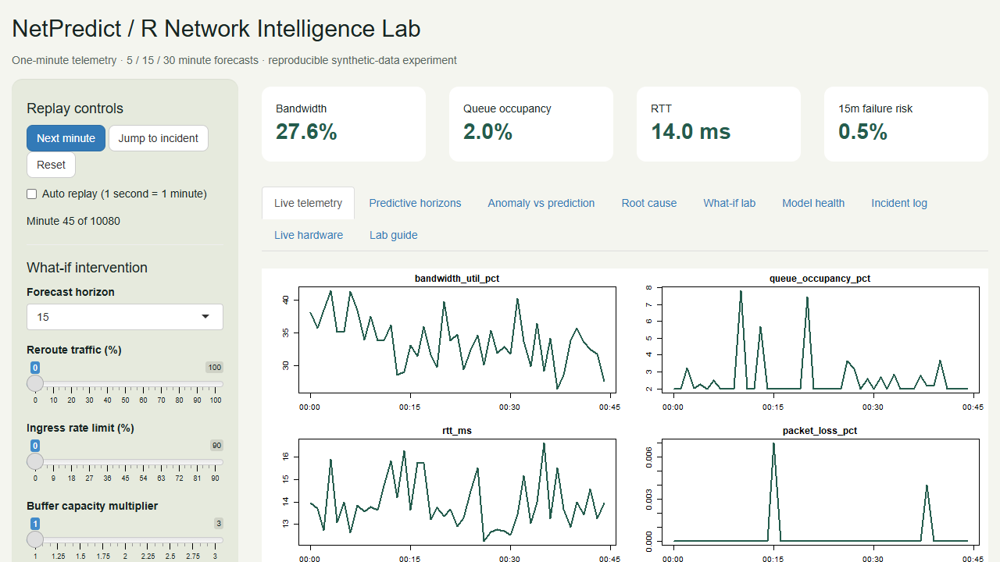

# NetPredict — R Programming Lab

An R application for network congestion forecasting, telemetry replay, explanations and mitigation experiments. This branch replaces the Python backend, React dashboard and Next.js documentation site with R modules, a Shiny dashboard, a Plumber API and an R Markdown lab notebook. No Python or Node.js runtime is needed.



## Run locally

Install R 4.3 or newer (RStudio is optional). Open `NetPredict.Rproj`, or open a terminal **in this repository root**:

```sh
Rscript scripts/setup.R
Rscript scripts/run_dashboard.R
```

Visit http://127.0.0.1:3838. The first launch trains models automatically; subsequent launches load `models/netpredict.rds`. Training may take a minute. Dependencies install into the ignored `.R-library` directory. If Windows cannot find Rscript, add your R installation's `bin` directory to PATH or use its full path.

In RStudio, use:

```r
source("scripts/setup.R")
shiny::runApp(".")
```

Optional REST server, in a second terminal:

```sh
Rscript scripts/run_api.R
```

API: http://127.0.0.1:8000/api/v1/health · Swagger: http://127.0.0.1:8000/__docs__/

Each dashboard session has independent replay state. The REST server has its own state; dashboard controls do not advance the REST playhead.

## Lab features

- Replay the bundled seven-day synthetic trace, step one minute, jump to an incident or reset.
- Explore 29 backward-looking instantaneous, rolling, slope, EWMA and congestion features.
- Predict failure probability, RTT and packet loss at **5, 15 and 30 minutes**.
- Compare Isolation Forest present-anomaly scores with calibrated future risk.
- Explain raw model probability using approximate permutation Shapley contributions.
- Compare rerouting, ingress shaping, buffer expansion and priority-queuing scenarios; search a bounded intervention grid.
- Inspect chronological holdout metrics, reliability bins, PSI drift and three baseline models.
- Log critical forecasts and match them to observations at the actual target timestamp.
- Read host interface throughput on Windows/Linux without inventing missing queue or loss measurements.

## Validation and analysis

```sh
Rscript scripts/test.R
Rscript scripts/train.R
Rscript scripts/smoke_api.R
Rscript scripts/smoke_dashboard.R
```

Training writes the model and `reports/model-health.json`. Unit/integration tests check leakage prevention, buffer isolation, input validation, model reload, explanation additivity, replay and intervention invariants. The HTTP smoke test starts and stops its own local API server.

Open `notebooks/NetPredict_ML_Pipeline.Rmd` in RStudio and select **Knit**, or run:

```r
rmarkdown::render("notebooks/NetPredict_ML_Pipeline.Rmd", knit_root_dir = getwd())
```

Rendering HTML requires Pandoc (included with RStudio). The R analysis chunks also run without Pandoc via `knitr::purl()` and `source()`.

## Containers

```sh
docker compose up --build
```

Dashboard: port 3838. API: port 8000. Live counters inside a container describe the container network namespace. Local R execution is the primary verified lab setup; see `docs/VALIDATION.md` for checks actually performed.

## Repository map

| Path | Purpose |
|---|---|
| `app.R` | Shiny dashboard and session logic |
| `R/telemetry.R`, `R/features.R` | Trace generation, validation, bounded buffers, temporal features |
| `R/models.R` | Training, calibration, forecasting, anomaly detection, explanation and evaluation |
| `R/service.R`, `R/simulation.R` | Replay, cached predictions, incidents and interventions |
| `R/api.R`, `R/collector.R` | Plumber routes and read-only OS counters |
| `scripts/` | Dependency setup, launchers, training and tests |
| `tests/testthat/` | R regression tests |
| `data/` | Original CSV datasets preserved from the source repository |
| `notebooks/` | R Markdown analysis |
| `docs/` | Architecture, API, migration and lab instructions |

## Important interpretation

This is a synthetic-data learning project, not a validated production early-warning system. A horizon means **minutes**, so forecasting requires at least 30 consecutive one-minute samples from the requested interface. Synthetic incident detection performance does not establish real-world advance warning. Models can perform similarly to simple persistence; inspect the baseline comparison.

The R implementation intentionally uses `ranger` probability forests instead of LightGBM, and approximate permutation Shapley values instead of TreeSHAP. Model outputs will differ. See `docs/MIGRATION.md` for the full mapping, removed assumptions, and compatibility changes.

Original project: [The-AnkitPatel/NetPredict](https://github.com/The-AnkitPatel/NetPredict), by Ankit Patel and contributors. The original implementation remains in `main` and Git history; this migration is on `codex/r-language-migration`.
